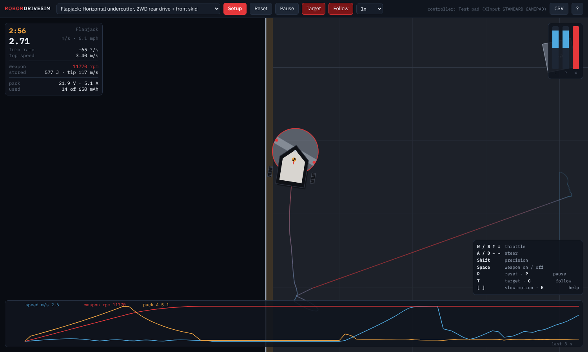
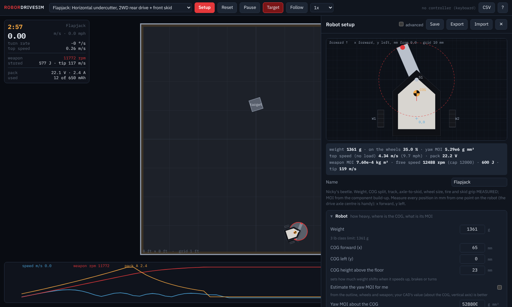

# RoborDriveSim

Drive your combat robot before it exists: its real weight, COG, wheels, tires, motors, battery and spinning
weapon, in an arena, with a keyboard or a game controller.

## Run it

- **Windows:** double-click `run.bat` (it opens your browser on a small local server; needs Python from python.org).
  No Python? Double-click `index.html` instead.
- **Mac / Linux:** `./run.sh`, or open `index.html` in Chrome or Edge.

Nothing to install, no internet needed: it is one page and plain JavaScript.

## Set up your robot

Press **Setup** and answer the questions. Start from an archetype and change what differs:

| Archetype | Layout |
|---|---|
| Flapjack | horizontal undercutter, 2WD at the back, steel skid under the weapon (Nicky's measured values) |
| Undercutter | the same layout with typical numbers |
| Vertical spinner | 2WD, front forks, vertical disc |
| Drum spinner | 2WD, front wedgelets, drum |
| Shell spinner | 2WD in the middle, ball casters, spinning ring |
| 4WD pusher | four wheels chained per side, no weapon |

What it asks:

- **Robot:** weight, COG (forward, left, height), yaw MOI (or let it estimate one), body outline.
- **Wheels:** how many, where (x, y), diameter, width, which side, driven or not; chained per side or one motor per
  wheel; tire.
- **Skids:** anything else touching the floor, and what it is made of.
- **Drive:** motor, ESC current limit, drag brake, drive voltage cap; battery cells and capacity.
- **Weapon:** horizontal, vertical or drum; where its centre is; diameter, spinning mass, shape, teeth, spin
  direction; weapon motor(s), reduction, ESC limit, speed cap.
- **Driving curves:** arcade, single-stick or tank mix; rate, expo, deadband and reverse for throttle and steering;
  steering left at full throttle; key ramp; precision; weapon toggle or hold.

Measure every position in mm from one point on your robot (the drive axle centre is handy), with x forward and
y left. Tick **advanced** for motor constants, tire curve, pack resistance and weapon inertia. **Save** keeps a robot
in your browser; **Export** and **Import** move it around as a `.robot.json` file.

## Drive

| | Keyboard | Game controller |
|---|---|---|
| Throttle / steer | W S A D or arrows | left stick up-down / right stick left-right (arcade) |
| Tank | W S left side, ↑ ↓ right side | one stick per side |
| Weapon | Space (toggle or hold) | right trigger (analog), A / Cross toggles |
| Precision | Shift | |
| Reset / pause | R / P | B / Circle, Start |
| Target box / follow camera | T / C | |
| Slow motion | [ and ] | |

**CSV** saves the last minute of driving (position, speed, commands, weapon rpm, battery current and voltage).

## What it simulates

- Each wheel's grip comes from the load on it, through a tire curve that rises, peaks and slides. Weight shifts
  back when you speed up, forward when you brake and outward in a turn, from the COG height. More than three contacts
  share the weight like a rigid plate on equal springs, and a contact that would have to pull lifts off.
- Motors have back-EMF, winding resistance, the ESC's current limit, drag brake or coast, and gearbox losses in the
  right direction. Drive and weapon share one battery with internal resistance, so spinning the weapon up sags the
  drive.
- The weapon spins up on its own motors. A horizontal weapon's spin-up twists the robot the other way. A vertical
  spinner or drum pitches it, and its gyroscope rolls the robot when you turn (watch for "off the floor").
- Skids slide with their own friction. Walls and the target box are contacts with friction. A tooth hitting the
  target is an impulse set by the blade's inertia, the target and your robot: it throws the target, slows the blade
  and kicks your robot back, once per tooth.

## Where the physics comes from

It is the Flapjack drive model from REDblocks (`reference/flapjack_drive_legacy.py`) made general: any wheels, skids
and weapon. That model matched a full 3D REDblocks simulation of Flapjack within about 4 % on launch, point turns,
braking and a fight's battery use. Set up as that model (5S, no weapon), this program gives the same answers:

| Flapjack | REDblocks planar model | RoborDriveSim |
|---|---|---|
| launch, time to 8 ft | 0.839 s | 0.840 s |
| top speed | 4.274 m/s | 4.274 m/s |
| peak acceleration | 1.10 g | 1.10 g |
| bus sag at 20 A | 16.51 V | 16.51 V |
| point turn, 90 / 360 deg | 0.174 / 0.379 s | 0.174 / 0.379 s |
| weapon spin-up yaw, brake on | 21 deg (3D model) | 19.7 deg |

Run the checks with `node tests/run_tests.js` (no packages needed).

## Limits

- A flat floor. Nothing flips over or leaves the ground. A vertical spinner's hit pushes the target along the floor
  (a share of its energy) instead of throwing it up.
- The archetypes' numbers and the parts marked "estimate" are typical values, not measurements. Replace them with
  yours. Flapjack's measured values: weight, COG split, track, axle-to-skid, wheel size, tire and skid grip.
