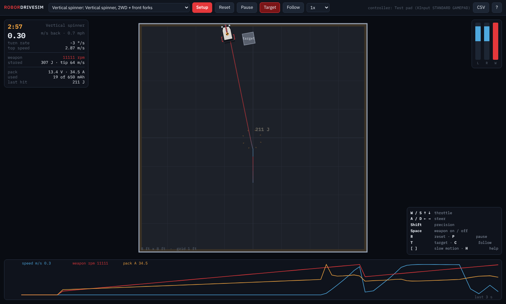

# RoborDriveSim

Drive your combat robot before it exists, in 3D: its real weight, COG, MOI, wheels, tires, motors, battery and
spinning weapon, in an arena, with a keyboard or a game controller. The camera follows the bot.

## Run it

- **Windows:** double-click `run.bat` (it opens your browser on a small local server; needs Python from python.org).
  No Python? Double-click `index.html` instead.
- **Mac / Linux:** `./run.sh`, or open `index.html` in Chrome or Edge.

Nothing to install, no internet needed: it is one page and plain JavaScript (three.js is included).

## Set up your robot

Press **Setup** and answer the questions. Start from an archetype and change what differs:

| Archetype | Layout |
|---|---|
| Flapjack | horizontal undercutter, 2WD at the back, steel skid under the weapon (Nicky's measured values) |
| Undercutter | the same layout with typical numbers |
| Vertical spinner | 2WD, front forks, vertical disc |
| Drum spinner | 2WD, front wedgelets, drum |
| Shell spinner | 2WD in the middle, ball casters set a hair high, spinning ring |
| 4WD pusher | four wheels chained per side, no weapon |

What it asks:

- **Robot:** weight; COG (forward, left, height); MOI (yaw from your CAD, roll and pitch too or in proportion, or let
  it estimate all three); body outline; body bottom and top heights.
- **Wheels:** how many; where (x, y); diameter and width; which side; driven or not. Then: chained per side, or one
  motor per wheel; and the tire.
- **Skids:** anything else touching the floor, what it is made of, and its gap (how far above the floor it sits at
  rest: a caster set a hair high lets the wheels carry the robot).
- **Drive:** motor, ESC current limit, drag brake, drive voltage cap; battery cells and capacity.
- **Weapon:** horizontal, vertical or drum; where its centre is (x, y and height); diameter, thickness, spinning mass,
  shape, teeth, spin direction; weapon motor(s), reduction, ESC limit, speed cap.
- **Driving curves:** arcade, single-stick or tank mix; rate, expo, deadband and reverse for throttle and steering;
  steering left at full throttle; invert when upside down; key ramp; precision; weapon toggle or hold.

Measure every position in mm from one point on your robot (the drive axle centre is handy), with x forward and y left.
Heights are above the floor. Tick **advanced** for motor constants, tire curve, pack resistance and weapon inertia.
**Save** keeps a robot in your browser; **Export** and **Import** move it around as a `.robot.json` file.

## Drive

| | Keyboard | Game controller |
|---|---|---|
| Throttle / steer | W S A D or arrows | left stick up-down, right stick left-right (arcade) |
| Tank | W S left side, ↑ ↓ right side | one stick per side |
| Weapon | Space (toggle or hold) | right trigger (analog), A / Cross toggles |
| Precision | Shift | |
| Reset / pause | R / P | B / Circle, Start |
| Target box | T | |
| Camera: chase, top, whole arena, orbit | C; drag to orbit, wheel to zoom | |
| Slow motion | [ and ] | |

**CSV** saves the last minute of driving: position, height, heading, pitch, roll, speed, commands, weapon rpm, battery
current and voltage.

## What it simulates

Full 3D: the chassis is a rigid body that pitches, rolls, wheelies, tips, flips and lands.

- **Wheels and tires.** Each tire is a spring and damper under its wheel's lowest point. It grips through a tire
  curve that rises, peaks and slides, on the load it actually carries. Weight shifts as it speeds up, brakes and
  turns, because the COG is above the floor.
- **Motors.** Back-EMF, winding resistance, the ESC's current limit, drag brake or coast, and gearbox losses in the
  right direction. Drive and weapon share one battery with internal resistance, so spinning the weapon up sags the
  drive.
- **The weapon's angular momentum rides in the chassis** (I ω' = M − ω × (I ω + H) − dH/dt):
  - spinning up twists the robot the other way about the weapon's axis: a horizontal weapon yaws it, a vertical one
    or a drum pitches it;
  - turning a robot with a spinning vertical disc or drum tilts it up (the gyro);
  - the drive's own rotors are gyros too.
- **Skids, the body and the weapon's rim** touch the floor, walls and ceiling with friction. A blade tipped onto the
  floor or clipping a wall drags at its real tooth speed: it slows the blade and kicks the robot.
- **The target box** is its own 3D body. A tooth hitting it is an impulse set by the blade's inertia, the target and
  your robot. It throws the target (a vertical sends it into the air), slows the blade and kicks your robot back,
  once per tooth.

## Where the physics comes from

It is REDblocks' Flapjack drive model made general: any wheels, skids and weapon. Set up the way the REDblocks 3D model
of Flapjack was (5S, no weapon), it gives the same answers:

| Flapjack | REDblocks 3D | RoborDriveSim |
|---|---|---|
| launch, time to 8 ft / 1 m | 0.805 / 0.467 s | 0.804 / 0.466 s |
| share on the wheels while they spin up | 74 % | 77 % |
| top speed | 4.275 m/s | 4.275 m/s |
| bus sag at 20 A | 16.50 V | 16.50 V |
| point turn, 90 / 180 / 360 deg | 0.175 / 0.253 / 0.379 s | 0.174 / 0.252 / 0.378 s |
| peak yaw rate | 1692 deg/s | 1691 deg/s |
| drag-brake stop from top speed | 0.83 s, 1.80 m | 0.82 s, 1.80 m |
| weapon spin-up yaw, brake on | 21 deg | 17 deg |

Run the checks with `node tests/test3d.js` (3D) and `node tests/run_tests.js` (the flat model it started from, plus
the driving curves). No packages are needed. `reference/flapjack_drive_legacy.py` is the original.

One thing it found: drive Flapjack hard while its weapon spins up, and the tires have no grip left to resist the
spin-up torque, so the chassis twists round. At about 2000 deg/s the drive motors' rotors act as gyros, and that is
enough to lift a wheel on its narrow wheel-to-skid tipping line. This depends on the weapon ESC limit and the rotor
inertia, both estimates.

## Limits

- A flat, rigid floor and walls. Contacts are springs and dampers (tires 20 kN/m, metal 200 kN/m). A hit is an
  impulse at one tooth, not a deformation.
- The archetypes' numbers and the parts marked "estimate" are typical values, not measurements: replace them with
  yours. Flapjack's measured values are its weight, COG split, track, axle-to-skid, wheel size, tire and skid grip.
  Its blade height (9 mm) and weapon ESC limit (30 A, for about a 1 s spin-up) are guesses.
